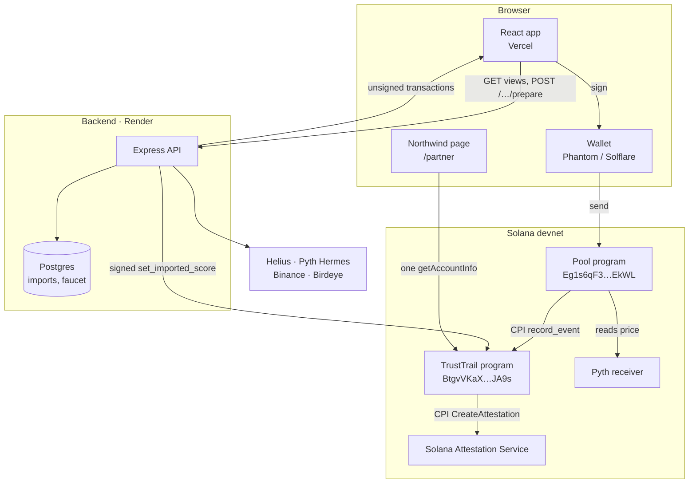
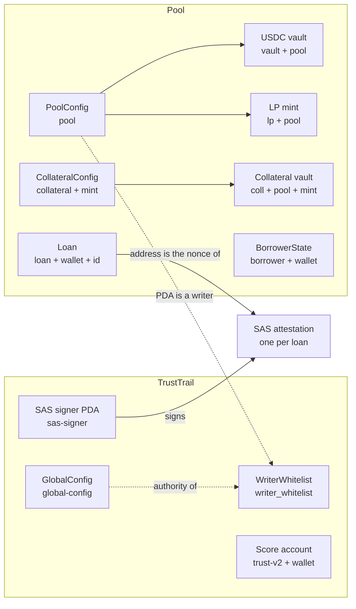
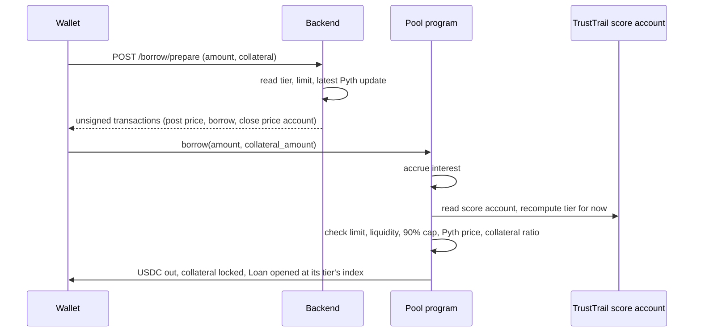
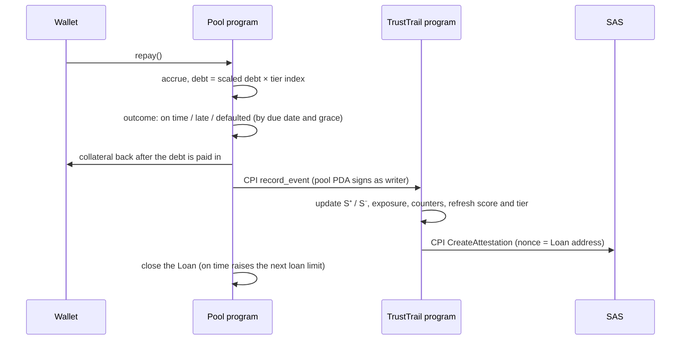

# Architecture

TrustTrail has four parts: two Anchor programs on Solana, a TypeScript backend and a React app. Everything that decides a score or a price runs on-chain. The backend builds unsigned transactions and imports outside history; it never holds a user's funds.

## Components

| Part | Code | Runs on | Job |
| --- | --- | --- | --- |
| TrustTrail program | `programs/trusttrail` | Solana | Owns every wallet's score account, the writer whitelist and the SAS signer. Turns closed loans into a score and a tier. |
| Pool program | `programs/pool` | Solana | Holds lender USDC, issues LP shares, prices and opens loans from the score account, takes repayments, liquidates, accrues interest. |
| Backend | `backend` | Render | Reads chain state into JSON views, builds unsigned transactions, imports lending history from five protocols, runs the tUSDC faucet, serves fresh Pyth updates. |
| App | `app` | Vercel | Score, Import, Borrow, Pool and Record pages, plus Northwind at `/partner`. Signs with the user's wallet. |

## On-chain accounts

Every account is a PDA, so any app can derive the address from the wallet alone. Full layouts and seeds are in the [Programs Reference](programs-reference.md).

## Flows

### Borrow

A first borrow also creates the score account (`init_score_v2`) in the same flow.

### Repay

The record is written in the same transaction as the repayment. If the attestation fails, the repayment fails too, so a closed loan always has its record.

### Liquidate

Anyone can liquidate a loan whose collateral is worth less than its threshold, or any loan three days past its due date. The liquidator pays the debt (or what the collateral covers), receives collateral at a bonus, and the pool records the loan as liquidated or defaulted through the same `record_event` CPI. Any shortfall comes out of the protocol's fee reserve first. See [Lending Pool](lending-pool.md).

### Import

The wallet signs a message, the backend fetches its history through Helius, rebuilds closed loans, prices them, scores them with the same formula the program uses, and returns a transaction already signed by its writer key. The wallet co-signs and the backend sends it. See [History Import](history-import.md).

### A second lender reads the record

Northwind (`app/src/partner.ts`) derives the score account address, fetches it with one `getAccountInfo` call, checks the owner and decodes the bytes in the browser. No TrustTrail server is involved. See [Lender Integration](lender-integration.md).

## Off-chain services

| Service | Used for |
| --- | --- |
| Helius | Enriched transaction history for the import |
| Pyth Hermes | Signed price updates posted with each borrow; the key stays on the backend |
| Binance, Birdeye | USD price of each imported loan at its peak |
| Postgres | Import records (public through `GET /import-history`), import preview cache and limits, faucet claims |

## Keys

| Key | Holds | Can do |
| --- | --- | --- |
| Admin (GlobalConfig authority) | Developer machine, not the backend | Add or remove writers |
| Pool authority | Developer machine, not the backend | Add collateral types |
| Backend writer key | Render env | `set_imported_score`, co-signed by the wallet |
| Faucet key | Render env | Mint tUSDC (the test token) |
| Pool PDA | No private key | Signs transfers and `record_event` from program code only |

## Deployment

| Part | Where |
| --- | --- |
| TrustTrail program | `BtgvVKaXQMJsRUdZ8ahuBftnwDpYtass15TqTwsJJA9s` on devnet |
| Pool program | `Eg1s6qF3UhrUYuccyKy9pMBqDQd4beQjYYYZdGs4EkWL` on devnet |
| Backend | `https://trusttrail-devnet-api.onrender.com` |
| App | `https://trusttrail-ten.vercel.app` |
