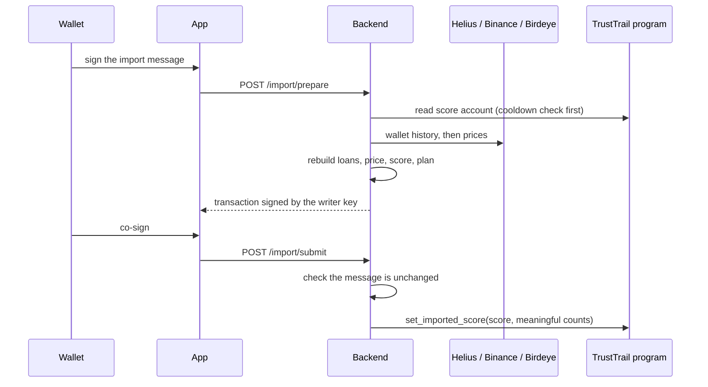

# History Import

A new wallet starts at Unproven even if it has repaid DeFi loans for years. The import reads that history from five Solana lending protocols and writes a score for it on-chain, so the wallet can start at a better tier on day one.

| Protocol | Loans read | Due dates |
| --- | --- | --- |
| Kamino Lend | borrow, repay, liquidation (top-level and inner instructions) | none (floating) |
| MarginFi v2 | borrow, repay, classic and receivership liquidations | none |
| Save (Solend) | borrow, repay, liquidation | none |
| Jupiter Lend | `operate` borrows and repays; liquidations from short repays and from each position's current state | none |
| Loopscale | fixed-term ledgers: borrow, repay, liquidation, rollovers | yes, from the term in force; 2-day grace |

## The flow

1. **Prove ownership.** The wallet signs a plain message valid for 7 minutes, so the backend spends Helius credits only on a wallet's real owner.
2. **Cooldown first.** If the last import was less than 15 days ago, the backend answers `429` before fetching anything.
3. **Fetch.** One pass over the wallet's history through Helius; every protocol adapter reads the same transactions. Jupiter Lend positions are also read through the Jupiter SDK, because its liquidations never name the position.
4. **Rebuild loans.** Events are grouped by protocol, position and token. A loan opens at the first borrow and closes when the debt reaches zero or the position is liquidated. Its principal is the **peak** debt. Loans still open are left out.
5. **Drop flash loans.** A loan repaid in the transaction that opened it put nothing at risk and is removed. Liquidations are always kept.
6. **Price.** Each loan is valued in USD at the moment of its peak: Binance first (SOL, USDC, JUP, BONK, JTO, against USDT), Birdeye as fallback, and both are asked when Binance's nearest price is more than 24 hours away. The smaller gap wins and is saved with the loan. Loans with no price at all are left out of the score but still listed publicly.
7. **Score.** The backend runs the same formula as the program ([Scoring Model](scoring-model.md)) over the whole priced history. Each penalty fades from the day it happened.
8. **Plan.** The score is rebuilt from the **whole** history every time, so old penalties keep fading. The meaningful on-time counts include only loans closed **after** the previous import, so nothing is counted twice.
9. **Write.** `set_imported_score` needs two signatures: the backend's whitelisted writer key and the wallet itself. The program caps the score at 1000, enforces the 15-day cooldown and adds the counts.
10. **Submit.** The wallet returns the co-signed transaction; the backend refuses it if a single byte of the message changed, sends it and marks the import confirmed.

## How the imported score is used

The program blends it with the native score, weighted by how much the wallet has borrowed through TrustTrail ([blend](scoring-model.md#4-blending-with-imported-history)). Imported meaningful loans count toward the Silver and Gold gates. An imported liquidation lowers the imported score, but it does not set the 90-day block, which only native liquidations do.

## Preview before importing

`GET /import-preview/:wallet` ([API](api-reference.md#get-import-previewwallet)) reads, prices and scores any wallet's history the same way, without a signature or a transaction. The Record page shows it in a card marked "Preview only, not a TrustTrail record". Results are cached for a few hours and fresh reads are rate limited per IP and per day, because each read spends Helius credits.

## Public and checkable

Every confirmed import is stored with every loan it counted: protocol, position, token, amount, USD value, price, price source, price time and gap, outcome and the signatures that opened and closed it. `GET /import-history/:wallet` returns it, so anyone can check a score against its loans. The Score page shows the same coverage per protocol.

## Limits

- The import is trusted through the backend's signature. The program cannot verify outside history itself; the wallet's co-signature only proves consent.
- Some prices come from Binance pairs in USDT, taken as 1 USDT = $1.
- Loans in a token with no price source are left out, including their liquidations.
- Each address's history is read up to 20 pages of 100 transactions and 730 days back; older loans are not seen. The preview says when the page limit was reached (`historyCapped`).
- Imports before multi-protocol support (Kamino only) are kept and shown with the protocols they actually checked.